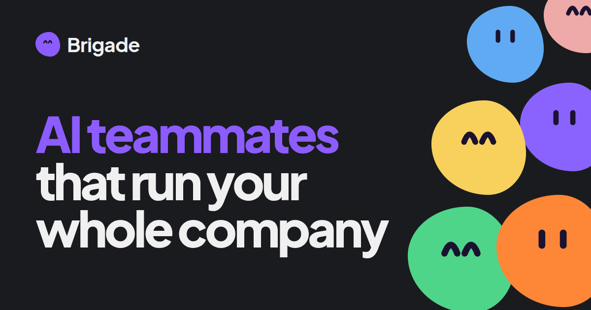
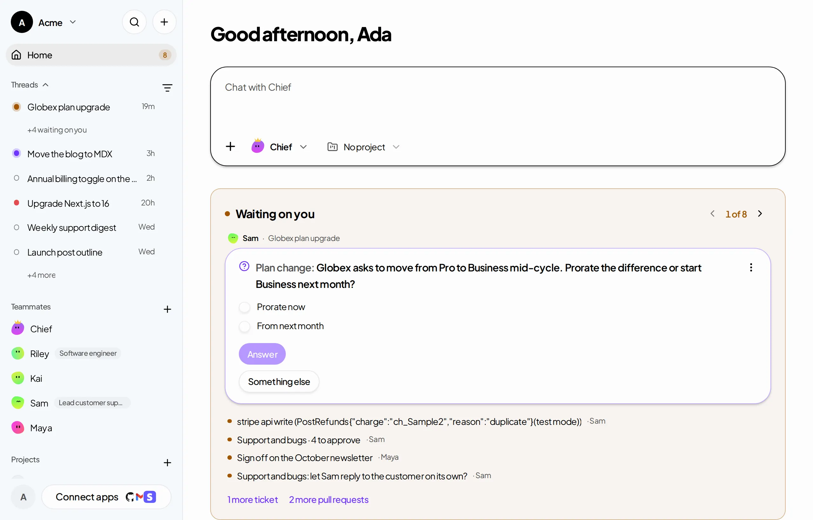

<p align="center">
  <a href="https://www.brigade.lol">
    
  </a>
</p>

<p align="center">
  <a href="https://www.brigade.lol"><strong>Website</strong></a> &middot;
  <a href="https://demo.brigade.lol"><strong>Live demo</strong></a> &middot;
  <a href="https://www.brigade.lol/how-it-works"><strong>How it works</strong></a> &middot;
  <a href="#run-it-locally"><strong>Run it locally</strong></a> &middot;
  <a href="docs"><strong>Docs</strong></a>
</p>

<p align="center">
  <a href="LICENSE"></a>
  <a href="https://github.com/gmpetrov/brigade/commits/main"></a>
  <a href="https://github.com/gmpetrov/brigade/pulls?q=is%3Apr+is%3Amerged"></a>
</p>

<br/>

<p align="center">
  <a href="https://demo.brigade.lol">
    <picture>
      <source media="(prefers-color-scheme: dark)" srcset="apps/web/public/landing/demo-dark.webp" />
      
    </picture>
  </a>
</p>

<p align="center">
  <a href="https://demo.brigade.lol"><strong>Click around the live demo →</strong></a>
</p>

<br/>

# AI teammates that run your whole company

Brigade gives you a team of AI teammates. They write your code, answer your customers, handle your marketing and
chase your leads, on the Claude or ChatGPT plan you already pay for. Every decision that needs you lands in one
list, on your phone.

Each teammate is the real **Claude Code** or **Codex**, signed in with your own account, with a job, its own
computer, the Apps you give it and a memory of how your team works. You talk to it in threads, the way you would
with a new hire.

**Hand off the work. Keep the decisions.**

|        | Step                 | Example                                                                                   |
| ------ | -------------------- | ----------------------------------------------------------------------------------------- |
| **01** | Create a teammate    | _Sam, support. Gmail and your Notion help center. Opus 5.5, on your Claude Max plan._     |
| **02** | Give it a job        | _"Sort every support email and draft the answers our docs already cover."_                |
| **03** | Approve what matters | _Sam wants to send a reply to jo@northwind.io. You read it in Needs you and tap Approve._ |

<br/>

<div align="center">
<table>
  <tr>
    <td align="center"><strong>Runs on</strong></td>
    <td align="center" valign="top"><br/><sub>Claude Code</sub></td>
    <td align="center" valign="top"><picture><source media="(prefers-color-scheme: dark)" srcset=".github/assets/logos/codex-dark.svg" /></picture><br/><sub>Codex</sub></td>
  </tr>
</table>

<em>Your Claude or ChatGPT plan. We never bill you for AI usage.</em>

<br/><br/>

<strong>Works in</strong>

<br/>

&nbsp;
&nbsp;
&nbsp;
&nbsp;
&nbsp;
<picture><source media="(prefers-color-scheme: dark)" srcset=".github/assets/logos/github-dark.svg" /></picture>&nbsp;
&nbsp;
&nbsp;
&nbsp;
&nbsp;
<picture><source media="(prefers-color-scheme: dark)" srcset=".github/assets/logos/posthog-dark.svg" /></picture>&nbsp;
&nbsp;
&nbsp;
&nbsp;
&nbsp;
&nbsp;
&nbsp;
&nbsp;
&nbsp;
&nbsp;
&nbsp;
&nbsp;


<sub>Plus any MCP server, a custom app that sends webhooks, and an email address of its own for each teammate.</sub>

</div>

<br/>

## Brigade is right for you if

- ✅ You build your product with **Claude Code or Codex** and run support, marketing and sales **on your own**
- ✅ You have **several agent sessions open** and lose track of which one does what
- ✅ You want agents that **start on their own** (a failed payment, a new issue, a customer's email) but **ask before
  they send, charge or ship**
- ✅ You already pay for **Claude Max or ChatGPT Pro** and don't want a second bill for AI usage
- ✅ You want to answer your teammates **from your phone**
- ✅ You want to **read every line** of the software that holds your passwords and your customers' email

<br/>

## Features

<table>
<tr>
<td align="center" width="33%" valign="top">
<h3>🧑‍💻 The real Claude Code and Codex</h3>
Teammates run the official CLIs, signed in with your accounts. Pick a harness and a model for each teammate.
</td>
<td align="center" width="33%" valign="top">
<h3>🔁 Stack your plans</h3>
Connect several Claude or ChatGPT accounts. When one hits its limit, the teammate carries on with the next one of
the same provider, in the middle of the task.
</td>
<td align="center" width="33%" valign="top">
<h3>✋ Needs you</h3>
For each teammate, choose what waits for your yes: an email, a change in Stripe, shipping code. Every request lands
in one list, with what it wants to do and why.
</td>
</tr>
<tr>
<td align="center" valign="top">
<h3>🖥️ A computer of its own</h3>
On your computer for free, or on Brigade's cloud computer. Move a thread between them with <em>Continue on…</em> and it
picks up where it left off.
</td>
<td align="center" valign="top">
<h3>🌐 Its own browser</h3>
Each teammate signs in to websites in its own browser. Brigade types the login from your vault: the teammate never
sees the password.
</td>
<td align="center" valign="top">
<h3>🖱️ Computer use</h3>
On your Mac, teammates read the screen, click and type in any app. On the cloud computer, take over and hand back
at any time.
</td>
</tr>
<tr>
<td align="center" valign="top">
<h3>🔌 Apps</h3>
Gmail, GitHub, Stripe, Notion, Linear, PostHog and more, or any MCP server. Read-only or read-write, teammate by
teammate.
</td>
<td align="center" valign="top">
<h3>⚡ Starts on its own</h3>
Triggers start a thread when something happens in an App or a webhook arrives. Routines run on a schedule.
</td>
<td align="center" valign="top">
<h3>🎓 Teach a task</h3>
Do a task once on a teammate's cloud computer while it watches. It writes the steps down as a skill and does it on
its own once you approve.
</td>
</tr>
<tr>
<td align="center" valign="top">
<h3>🧠 Memory and library</h3>
What your team decides goes into the workspace's memory. Documents, designs and files live in a shared library
every teammate can search.
</td>
<td align="center" valign="top">
<h3>🚀 Code, previewed</h3>
Teammates open pull requests, start a live preview of your app in the thread, and ask another teammate to review
before you merge.
</td>
<td align="center" valign="top">
<h3>📱 On your phone</h3>
Install the dashboard on your phone and get a push when a teammate needs you. A tap opens what it is waiting
for.
</td>
</tr>
<tr>
<td align="center" valign="top">
<h3>📋 Tasks and projects</h3>
A Tasks board for the work in flight, and projects that keep each product's threads, files and repositories apart.
</td>
<td align="center" valign="top">
<h3>✉️ Email of its own</h3>
Turn on the Email App and each teammate gets an address. Replies come back to the teammate that started the
conversation.
</td>
<td align="center" valign="top">
<h3>📜 Every step logged</h3>
Open any thread to see what the teammate did, read and changed, step by step. Daily caps on threads, computer
hours and writes to each App.
</td>
</tr>
</table>

<br/>

## Problems Brigade solves

| Without Brigade                                                                                   | With Brigade                                                                                                        |
| ------------------------------------------------------------------------------------------------- | ------------------------------------------------------------------------------------------------------------------- |
| ❌ Ten terminal tabs of Claude Code, and no idea which one is waiting on you.                     | ✅ Threads with a status dot each, and one list of what waits for your answer.                                      |
| ❌ An agent with every tool and no owner gets vague fast.                                         | ✅ Each teammate holds one job, with its own Apps, memory and rules. You see who did what.                          |
| ❌ You re-explain your product, your tone and last week's decision at the start of every session. | ✅ The workspace's memory and skills carry what your team decided into every thread.                                |
| ❌ Your laptop closes and the agent stops.                                                        | ✅ Move the thread to the cloud computer. It keeps working while yours is off.                                      |
| ❌ Your plan hits its limit mid-task and the work stalls until the reset.                         | ✅ The teammate switches to your next account of the same provider and carries on.                                  |
| ❌ Support, follow-ups and weekly reports wait until you remember them.                           | ✅ A trigger or a routine starts the teammate, and only the decisions come to you.                                  |
| ❌ An agent with your API keys in a prompt can send, charge or delete whatever it likes.          | ✅ Passwords stay in the vault, each App is read-only or read-write per teammate, and writes can wait for your yes. |

<br/>

## How it works

```
                 ┌───────────────────────────────────────────────────────────┐
  You, on the    │                      BRIGADE  (this repo)                 │
  web or your ──►│                                                           │
  phone          │  Dashboard ── API ── PostgreSQL                           │
                 │  threads · Needs you · tasks · library · memory · vault   │
                 │  Apps · triggers · routines · usage and caps              │
                 └──────────────┬──────────────────────────────┬─────────────┘
                                │ WebSocket                    │ MCP tools
                 ┌──────────────┴───────────────┐     ┌────────┴──────────────┐
                 │  Runner, on your computer    │     │  Gmail, GitHub,       │
                 │  or a cloud computer         │     │  Stripe, Notion,      │
                 │                              │     │  Linear, PostHog…     │
                 │  Claude Code · Codex         │     │  any MCP server       │
                 │  browser · computer use      │     └───────────────────────┘
                 │  your repos and previews     │
                 └──────────────────────────────┘
```

- **The dashboard and API** hold the workspace: teammates, threads, tickets, the library, memory, the vault and
  the Apps. Every step a teammate takes is stored as an event, so a thread survives disconnects and replays.
- **The runner** links a computer to the workspace and runs each thread with the real Claude Code or Codex CLI,
  signed in with the member's own account. It strips API keys from its environment, so the work runs on the
  subscription, never on a server-side key.
- **Apps** reach teammates as tools. Writes can wait for a person's approval, and every call is logged.

The details are in [docs/](docs), and the choices made along the way in [docs/decisions.md](docs/decisions.md).

<br/>

## Free or Brigade Cloud

Brigade is open source under the MIT license. The whole product is in this repository: we don't gate features.

|                                 | Free                                              | Brigade Cloud                                                                |
| ------------------------------- | ------------------------------------------------- | ---------------------------------------------------------------------------- |
| **Price**                       | $0                                                | $99 a month per workspace                                                    |
| **Where it runs**               | Teammates run on your own computer while it's on  | Teammates get a computer of their own, which keeps working when yours is off |
| **AI usage**                    | Your Claude or ChatGPT plan                       | Your Claude or ChatGPT plan                                                  |
| **Teammates, threads, members** | Unlimited                                         | Unlimited                                                                    |
| **Teach a task, takeover**      | Not yet                                           | Yes, on the cloud computer                                                   |
| **Self-hosting**                | Run the whole stack yourself from this repository | Hosted by us at [brigade.lol](https://www.brigade.lol)                       |

Cancel Cloud from Settings whenever you want: it stops at the end of the month you paid for, your workspace stays,
and your teammates keep working for free on your own computer.

<br/>

## Quickstart

### Use it

[Sign up at brigade.lol](https://www.brigade.lol/sign-up), create a teammate, and link your computer from
**Computers**: on a Mac, Brigade.app does it in one click; on Linux or macOS, copy the one-line install command
shown there. Or skip it with Brigade Cloud. Then write to your teammate.

### Run it locally

With **Node.js 24** (`.nvmrc`), **pnpm** and **Docker**:

```bash
git clone https://github.com/gmpetrov/brigade.git
cd brigade
pnpm install
docker compose up -d                       # PostgreSQL on localhost:5433
cp apps/api/.env.example apps/api/.env     # then set BETTER_AUTH_SECRET
pnpm --filter @brigade/api db:migrate
pnpm dev                                   # API :3001, dashboard :3000, collab :8787
```

Open http://localhost:3000, create an account, an organization and a workspace, then a teammate. To run its
threads, link this machine from **Computers → Get a link code**, in a shell where `claude` (or `codex`) is signed
in:

```bash
pnpm --filter @brigade/runner build
node apps/runner/dist/index.js link <CODE> --api http://localhost:3001
node apps/runner/dist/index.js start
```

No Docker? `scripts/preview/setup.sh` then `scripts/preview/start.sh` run everything on an embedded PostgreSQL, with
a sample workspace to sign in to (see [AGENTS.md](AGENTS.md)).

More in [docs/development.md](docs/development.md): Brigade.app and computer use on macOS, the theme, and the
runner's options.

### Self-host

Brigade deploys two ways from one codebase: one server with Docker Compose ([deploy/vps](deploy/vps)), or Cloudflare
Workers with Durable Objects, R2 and Hyperdrive. See [docs/deployment-plan.md](docs/deployment-plan.md).

<br/>

## Repository layout

pnpm workspaces and Turborepo.

| Path                      | What it is                                                                                                                |
| ------------------------- | ------------------------------------------------------------------------------------------------------------------------- |
| `apps/api`                | Hono on Node.js: auth, workspaces, teammates, threads, Apps, the WebSocket hub. The only package that touches PostgreSQL. |
| `apps/web`                | Next.js dashboard and landing page.                                                                                       |
| `apps/runner`             | `brigade-runner`: links a computer to a workspace and runs its threads with Claude Code or Codex.                         |
| `apps/collab`             | Cloudflare Worker: one Durable Object per document people edit together, synced over Yjs.                                 |
| `apps/preview-gateway`    | Cloudflare Worker that serves the live previews of the apps teammates work on.                                            |
| `apps/desktop`            | Brigade.app (Tauri): menu-bar app that installs, links and runs the runner on a Mac, and updates itself.                  |
| `apps/computer-use-macos` | Brigade Computer Use.app (Swift): holds Screen Recording and Accessibility for the runner's `computer_*` tools.           |
| `packages/contracts`      | Zod schemas shared by everything: events, API payloads, socket messages.                                                  |
| `packages/editor`         | The document editor's schema and lossless Markdown conversion.                                                            |
| `packages/providers`      | The interface to cloud computer providers.                                                                                |

```bash
pnpm dev          # everything, in watch mode
pnpm build        # build all packages
pnpm typecheck    # type-check all packages
pnpm format       # Prettier
```

<br/>

## Documentation

| Topic                              | Page                                               |
| ---------------------------------- | -------------------------------------------------- |
| Routines, schedules and triggers   | [docs/automations.md](docs/automations.md)         |
| Memory                             | [docs/memory.md](docs/memory.md)                   |
| Skills                             | [docs/skills.md](docs/skills.md)                   |
| Projects                           | [docs/projects.md](docs/projects.md)               |
| Tasks                              | [docs/tasks.md](docs/tasks.md)                     |
| Previews                           | [docs/previews.md](docs/previews.md)               |
| Email                              | [docs/email.md](docs/email.md)                     |
| Notifications                      | [docs/notifications.md](docs/notifications.md)     |
| Usage and caps                     | [docs/usage.md](docs/usage.md)                     |
| Billing                            | [docs/billing.md](docs/billing.md)                 |
| Cloud computer backups             | [docs/cloud-backups.md](docs/cloud-backups.md)     |
| Monitoring                         | [docs/monitoring.md](docs/monitoring.md)           |
| Deployment                         | [docs/deployment-plan.md](docs/deployment-plan.md) |
| The public demo                    | [docs/demo.md](docs/demo.md)                       |
| Decisions where the spec is silent | [docs/decisions.md](docs/decisions.md)             |

<br/>

## Brigade is built by Brigade

Most of the commits in this repository come from Brigade's own teammates, and a person approves every change
before it goes in. Browse the [merged pull requests](https://github.com/gmpetrov/brigade/pulls?q=is%3Apr+is%3Amerged):
the branches named `brigade/…` are theirs.

<br/>

## FAQ

**Do I need to know how to code?**

No. You describe a job in a message, the way you would to a new hire. For a task in a website or an app, take over
a teammate's cloud computer and show it once.

**Which AI plans work?**

Claude plans through Claude Code, and ChatGPT plans through Codex. Max or Pro gives the most room. Pick a model per
teammate, and stack several accounts of the same provider.

**Why several teammates rather than one agent?**

Each teammate holds one job, with its own Apps, memory and rules, so you see who did what and fix the one that is
off.

**Where do my passwords go?**

In your workspace's vault. When a teammate signs in to a website, Brigade types the login for it: the teammate
never sees the password.

**Is my data used to train AI models?**

Not by us. The work runs on the AI plan you bring, so your data goes only to the provider you picked, under the
terms of your plan.

**Can my team see the work?**

Yes. Invite them to your workspace: threads, tasks and files are shared, so nothing sits in one person's chat
history.

<br/>

## Contributing

Issues and pull requests are welcome. Before opening one, run `pnpm typecheck` and `pnpm format:check`, and the
tests of the packages you changed (`pnpm --filter <package> test`). Pull requests are squash-merged.

<br/>

## License

MIT &copy; 2026 Georges Petrov. See [LICENSE](LICENSE).

<br/>

---

<p align="center">
  <sub>Open source under MIT. Built by a team of people and AI teammates, with every change approved by a person.</sub>
</p>
